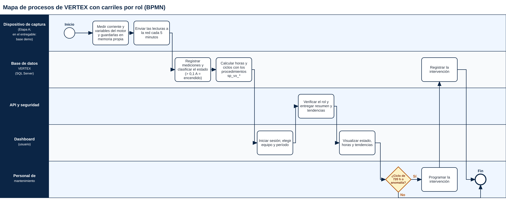
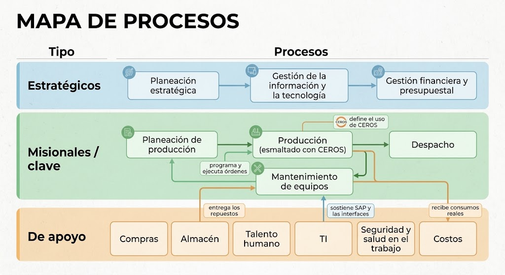

# T10 · Mapa de procesos con carriles (BPMN)

**Fecha de elaboración:** 31/10/2026 (elaborado después de la fecha de plan de la tarea, 11/09–18/09, que es de planificación).
**Archivo:** `bpmn_vertex.png`.

Mapa de procesos de VERTEX con 5 carriles por rol: dispositivo de captura, base de datos, API y seguridad, dashboard y personal de mantenimiento. Resume el flujo documentado en el DERS y en el Taller: medición, envío cada 5 minutos, registro y clasificación del estado (corriente > 0,1 A = encendido), cálculo de horas y ciclos con los `sp_vx_*`, inicio de sesión y verificación de rol, visualización y decisión de intervención (ciclo objetivo de 720 horas o anomalía).

Notas:
- La captura física es de la Etapa A; en el entregable, la fuente de datos es la base demo.
- El mapa por franjas del Proyecto Integrador §16 (`mapa_de_procesos.png`, en esta carpeta) se conserva como mapa de procesos estratégicos, misionales y de apoyo; este BPMN lo complementa con carriles por rol.
- El ciclo objetivo de 720 horas corresponde al parámetro `HORAS_CICLO_OBJETIVO` de `ConfiguracionSistema` (valor 720, descrito como provisional: 90 días × 8 h/día), definido en `database/seeds/01_reference_data.sql`.

